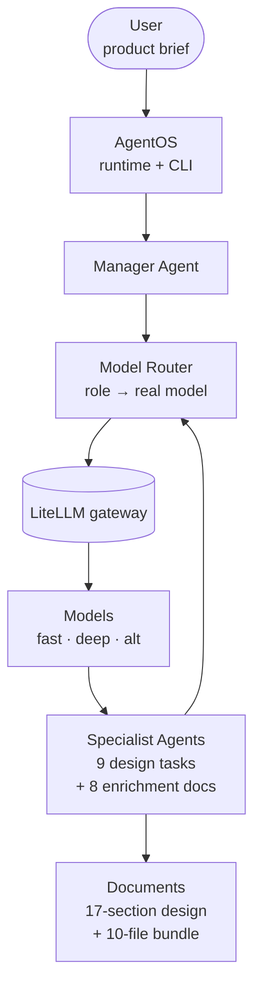

# AI Product Orchestrator

A **multi-agent, multi-model AI product design orchestrator**. Give it a product brief; it runs a
scored 13-step design pipeline and produces a 17-section system design **plus eight deep,
specialized technical documents** a development team can build from — and a **gap-filling refine
pass** that closes the specific completeness gaps (DDL, OpenAPI, payment/reporting flows,
observability, UI flows) the document gate names. All through a single **LiteLLM** gateway, fully
**Docker-Compose** deployable.

Built on [Agno AgentOS](https://github.com/agno-agi/agno).

> ## 📍 Where the project actually stands (read these first)
>
> **Full technical audit — 2026-10-21 (live re-verification, evidence-based):**
> - 📊 **Project Status Report** → [audit_2026_10_21/PROJECT_STATUS_REPORT.md](audit_2026_10_21/PROJECT_STATUS_REPORT.md)
> - 🏛️ **Architecture Report** → [audit_2026_10_21/PROJECT_ARCHITECTURE.md](audit_2026_10_21/PROJECT_ARCHITECTURE.md)
> - 🧪 **Test Report** → [audit_2026_10_21/PROJECT_TEST_REPORT.md](audit_2026_10_21/PROJECT_TEST_REPORT.md)
> - 🐛 **Issues & Roadmap** → [audit_2026_10_21/PROJECT_ISSUES_AND_ROADMAP.md](audit_2026_10_21/PROJECT_ISSUES_AND_ROADMAP.md)
> - ✅ **Test & Observability Checklist (living)** → [docs/PROJECT_TEST_AND_OBSERVABILITY_CHECKLIST.md](docs/PROJECT_TEST_AND_OBSERVABILITY_CHECKLIST.md)
>
> Standing reference (from the 2026-10-20 handover audit):
> - ✅ **Project Status — verified 2026-10-20 audit** → [docs/PROJECT_STATUS.md](docs/PROJECT_STATUS.md)
> - 🗺️ **Roadmap — remaining tasks, priorities, dependencies** → [docs/ROADMAP.md](docs/ROADMAP.md)
> - 🤖 **AI Handoff / next-chat checkpoint** → [docs/AI_HANDOFF.md](docs/AI_HANDOFF.md)
> - 🧪 **Test Matrix (per-module coverage, gaps stated plainly)** → [docs/TEST_MATRIX.md](docs/TEST_MATRIX.md)
>
> Current state in one line (re-verified live 2026-10-21): the pipeline is real, deployed, and
> tested (30 hermetic tests green, re-run in-container during the 2026-10-21 audit), both
> instances healthy, deploy target byte-identical to `main` — but the two quality gates
> (design ≥85, doc-completeness ≥80) are **not yet met** (latest real run: 71 / 79) and the
> observability build (trace_id / structured logging / `/metrics` / Prometheus+Grafana) is
> **not started**. Details + evidence: the four audit links above.

> ## 🏅 The Golden Rule — tests **and** observability
> **Nothing in this repo is "complete" without BOTH tests AND an observable, traceable execution
> path.** "Code written" is not done. This is the permanent Definition of Done for every module,
> agent, API, pipeline, and deployment here (and the standard STEP 10 ships from the start):
> per-step tests, a global `run_id`/`trace_id`, structured logs, health checks, metrics,
> Prometheus + Grafana, and a per-run report.
>
> - 🧪 **Testing & Test Matrix** → [docs/TESTING.md](docs/TESTING.md)
> - 👁️ **Observability standard (14 points)** → [docs/OBSERVABILITY.md](docs/OBSERVABILITY.md)

## Status

| | |
|---|---|
| 🔵 **CI (server52 runner)** | [](https://git.ai.ismc.ir/common/website/ai-product-orchestrator/-/commits/main) — hermetic tests on every push/MR/tag: **no LLM, no API key, no cost** |
| 🚀 **Deployment Guide** | [docs/DEPLOYMENT.md](docs/DEPLOYMENT.md) |
| 🔌 **LiteLLM Deployment Modes** | [docs/LITELLM.md](docs/LITELLM.md) — **External** gateway (default) vs **Bundled sidecar** |
| 🤖 **AI HANDOFF / Next Chat** | [docs/AI_HANDOFF.md](docs/AI_HANDOFF.md) — full project state for picking up where this left off |
| 📦 **Latest Release** | [`v0.3.0`](https://git.ai.ismc.ir/common/website/ai-product-orchestrator/-/tags) (Semantic Versioning — see [docs/RELEASES.md](docs/RELEASES.md)) |
| 🏛️ **Architecture** | [docs/ARCHITECTURE.md](docs/ARCHITECTURE.md) |
| 🛠️ **Developing** | [docs/DEVELOPMENT.md](docs/DEVELOPMENT.md) |
| 🏠 **Repository** | <https://git.ai.ismc.ir/common/website/ai-product-orchestrator> |

> **CI:** the pipeline (on the self-hosted `server52` runner) builds the locked Python
> environment in a container, syntax-checks the package, and runs the hermetic test suite
> (30 tests) with **no model and no network to LiteLLM** — then deploys `main` to the server.
> The same `scripts/ci.sh` body is also wired for GitHub Actions (`.github/workflows/ci.yml`)
> if the repo is ever mirrored there.

---

> ## 🚀 Quick Start
> **For new server deployment, see:** [docs/DEPLOYMENT.md](docs/DEPLOYMENT.md)
>
> <details><summary>TL;DR</summary>
>
> ```bash
> git clone https://git.ai.ismc.ir/common/website/ai-product-orchestrator.git ai-product-orchestrator
> cd ai-product-orchestrator
> cp .env.example .env      # Mode A: fill LITELLM_BASE_URL + LITELLM_API_KEY
> docker compose up -d            # Mode A (external gateway — the default)
> # Mode B (no gateway yet — start a bundled LiteLLM sidecar instead):
> #   cp .env.example .env        # fill LITELLM_MASTER_KEY + *_MODEL_API_*
> #   docker compose --profile bundled-litellm up -d
> docker compose logs -f
> ```
>
> See [docs/LITELLM.md](docs/LITELLM.md) for the two modes.
> </details>

---

## 📌 Documentation

- 🤖 **AI HANDOFF / Next Chat** — [docs/AI_HANDOFF.md](docs/AI_HANDOFF.md) — full project state: architecture, servers, version, model routing, STEPS 1–9, latest tests/release, open problems, next STEP
- 🔌 **LiteLLM Deployment Modes** — [docs/LITELLM.md](docs/LITELLM.md) — external gateway vs bundled sidecar
- 🤖 **AGENTS.md** — orientation for AI coding agents (commands, CI/CD gotchas, hard rules)
- 🚀 **Deployment Guide** — [docs/DEPLOYMENT.md](docs/DEPLOYMENT.md)
- 🏛️ **Architecture** — [docs/ARCHITECTURE.md](docs/ARCHITECTURE.md)
- ⚙️ **Configuration** — [docs/CONFIGURATION.md](docs/CONFIGURATION.md)
- 🤖 **Agent Design** — [docs/AGENT_DESIGN.md](docs/AGENT_DESIGN.md)
- 🛠️ **Developer Workflow** — [docs/DEVELOPMENT.md](docs/DEVELOPMENT.md)
- 📦 **Releases** — [docs/RELEASES.md](docs/RELEASES.md)
- 🧪 **Testing & Test Matrix (Golden Rule)** — [docs/TESTING.md](docs/TESTING.md)
- 👁️ **Observability (14-point standard)** — [docs/OBSERVABILITY.md](docs/OBSERVABILITY.md)
- 🧭 **Tracing** — [docs/TRACING.md](docs/TRACING.md) · ✍️ **Logging** — [docs/LOGGING.md](docs/LOGGING.md)
- ❤️ **Health Checks** — [docs/HEALTHCHECKS.md](docs/HEALTHCHECKS.md) · 📊 **Metrics** — [docs/METRICS.md](docs/METRICS.md)
- 📈 **Grafana** — [docs/GRAFANA.md](docs/GRAFANA.md) · 🔄 **CI/CD** — [docs/CI_CD.md](docs/CI_CD.md)

## Project Overview

The AI Product Orchestrator turns a natural-language **product brief** into concrete, scored,
buildable design artifacts. It runs a **13-step multi-model pipeline** (product analysis → master
prompt → 9 parallel specialist tasks → merge → a critic/fix/refine quality loop → a 17-section
final deliverable), and then an **enrichment layer** that fans out into **eight specialist
documents** (Backend, Database, API, Frontend, UX, Security, Testing, Deployment) with a
document-completeness gate and full decision traceability. A final **gap-filling refine pass**
re-runs only the documents the gate flagged as gapful — injecting each one's named gaps (missing
DDL, no exact OpenAPI, underspecified payment/reporting/observability/UI flows) plus the agent's
own draft — so it *fills the holes* and re-scores, lifting document completeness from the ~79 a
single pass leaves to 85+ territory.

Everything is **model-agnostic**: agents resolve a *logical role* (`fast`/`deep`/`alt`) that is
mapped to a real model by name, and every call goes through **one LiteLLM endpoint**. Swap the
whole model fleet by editing `.env` — no code changes.

## Features

- **AgentOS Runtime** — Agno AgentOS HTTP service (health/docs/agents) on port 7777.
- **Multi-Model Routing** — logical roles → real models; ≥3 distinct models per run; no model
  names hardcoded in agents.
- **LiteLLM Integration** — a single OpenAI-compatible gateway for every call, in two modes:
  connect to an **external** LiteLLM you already run (default), or bring up a **bundled sidecar**
  this repo starts on a fresh server (see [docs/LITELLM.md](docs/LITELLM.md)).
- **Product Analysis** — structured extraction of the brief (goals, users, constraints).
- **Architecture Generation** — a 13-section master design prompt.
- **Backend Design** · **Database Design** · **API Design** · **Frontend Design** — deep
  enrichment documents, each with decisions, components, risks, and implementation notes.
- **Testing Strategy** — unit / integration / API / E2E / performance / security plans.
- **Critic Loop** — targeted critic → atomic, acceptance-tested fixes → refiner → rebuild →
  patch verifier, iterating against a shared quality rubric.
- **Quality Gate** — 11-dimension weighted score (computed, not free-text); a separate
  **document-completeness gate** for the 8 enrichment documents.
- **Gap-filling Refine Pass** — a targeted 2nd enrichment pass that re-runs only the
  documents the completeness gate named as gapful (DDL / OpenAPI / payment / reporting /
  observability / UI flows), overwrites the bundle, and re-scores — lifting completeness
  from a single pass's ~79 toward 85+.
- **Document Generation** — a deterministic Document Manager writes a 10-file markdown bundle +
  a traceability index (every decision → source + reason).
- **Honest Token Ledger** — real model + tokens read back from run metrics; per-model budget
  breakdown; stubs excluded from real totals.

## Architecture Diagram



Conceptually:

```
User
  |
AgentOS
  |
Manager Agent
  |
Router
  |
LiteLLM
  |
Models
  |
Specialist Agents
  |
Documents
```

## Quick Start

```bash
git clone https://git.ai.ismc.ir/common/website/ai-product-orchestrator.git ai-product-orchestrator
cd ai-product-orchestrator

cp .env.example .env          # then fill in the block for your mode (below)

# Mode A — you already run a LiteLLM gateway (the default):
#   .env:  LITELLM_BASE_URL, LITELLM_API_KEY, AGENT_MODEL_*
docker compose up -d

# Mode B — no gateway yet; start a bundled LiteLLM sidecar:
#   .env:  LITELLM_MODE=bundled, LITELLM_MASTER_KEY, *_MODEL_API_*
docker compose --profile bundled-litellm up -d

docker compose logs -f
```

Full details for both modes: [docs/LITELLM.md](docs/LITELLM.md).

Verify it's up:

```bash
curl -s localhost:7777/health        # -> {"status":"healthy", ...}
./scripts/healthcheck.sh             # container + health + routing
docker compose exec agno-agentos uv run python -m workflow.run endpoint   # -> which mode/URL
```

Run a pipeline (once healthy):

```bash
# full design + 8 enrichment documents:
docker compose exec agno-agentos uv run python -m workflow.run \
  enrich --brief "B2B sales management with CRM, customers, orders, sales reports and org roles"

# ...and the gap-filling refine pass (closes DDL / OpenAPI / payment / observability gaps):
docker compose exec agno-agentos uv run python -m workflow.run \
  refine --brief "B2B sales management with CRM, customers, orders, sales reports and org roles"
```

See [docs/DEPLOYMENT.md](docs/DEPLOYMENT.md) for the full deployment, update, and backup guide.

## Configuration

Point at your gateway and models in `.env` (Mode A shown; Mode B in
[docs/LITELLM.md](docs/LITELLM.md)):

```ini
# Mode A — external gateway (default)
LITELLM_MODE=external
LITELLM_BASE_URL=http://172.30.0.133:4000/v1
LITELLM_API_KEY=<your-key>
AGENT_MODEL_FAST=qwen38-nothinking
AGENT_MODEL_DEEP=qwen38
AGENT_MODEL_ALT=qwen38-sglang
```

No secrets live in the repo. Full reference: [docs/CONFIGURATION.md](docs/CONFIGURATION.md) and
[docs/LITELLM.md](docs/LITELLM.md).

## Repository layout

```
ai-product-orchestrator/
├── README.md
├── AGENTS.md                  # agent/developer orientation + CI/CD gotchas
├── docker-compose.yml
├── Dockerfile
├── .env.example
├── .gitignore
├── .dockerignore
├── .gitattributes           # force LF for *.sh/*.py/*.yml (Linux/Docker-safe)
├── .gitlab-ci.yml             # GitLab CI on the server52 shell runner (test → deploy)
├── .github/workflows/ci.yml   # GitHub Actions (same scripts/ci.sh) if mirrored there
├── conftest.py                # pytest bootstrap (makes `workflow` importable)
├── LICENSE
├── personal_agent.py          # AgentOS HTTP entrypoint (:7777)
├── pyproject.toml / uv.lock   # Python 3.13 + agno[os,sqlite]
├── litellm/                   # STEP 9 bundled sidecar (Mode B)
│   ├── config.yaml            #   routing TEMPLATE, no secrets (${VAR}-driven)
│   └── entrypoint.sh          #   renders the config from env, then starts LiteLLM
├── workflow/                  # the orchestrator package
│   ├── engine.py              # 13-step pipeline + enrichment + gap-filling refine pass
│   ├── router.py              # role→model + token ledger
│   ├── config.py              # single source of truth
│   ├── schemas.py             # Pydantic artifacts
│   ├── prompts.py             # role prompts + shared rubric
│   ├── models.py              # model factory
│   ├── state.py               # per-step state persistence
│   ├── run.py                 # CLI (smoke / routing / full / enrich / refine)
│   ├── agents/                # Manager, ProductAnalyst, 8 enrichment, DocumentManager
│   ├── tests/                 # hermetic test suites
│   └── storage/               # runs + documents (gitignored, volume-mounted)
├── docs/                      # ARCHITECTURE / DEPLOYMENT / CONFIGURATION / AGENT_DESIGN / DEVELOPMENT / RELEASES / LITELLM / AI_HANDOFF
├── scripts/                   # install.sh / start.sh / healthcheck.sh / ci.sh / ci-docker.sh / deploy-repo.sh
└── tests/                     # README pointing at workflow/tests (run in-container)
```

## Tests

The test suites are hermetic (a fake router — no real LLM, no LiteLLM, no API key) and live in
`workflow/tests/` (**30 tests**). Run them inside the container:

```bash
docker compose exec agno-agentos uv run python -m workflow.tests.test_full_pipeline
docker compose exec agno-agentos uv run python -m workflow.tests.test_enrichment
docker compose exec agno-agentos uv run python -m workflow.tests.test_refine
docker compose exec agno-agentos uv run python -m workflow.tests.test_endpoint   # STEP 9 mode selection
```

Or run the whole suite the way CI does:

```bash
docker compose exec agno-agentos uv run --with pytest python -m pytest workflow/tests -q
```

## License

[MIT](LICENSE).
